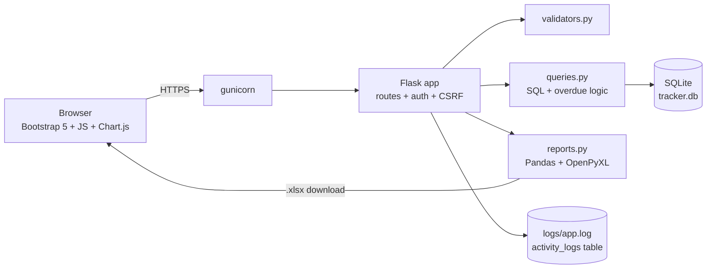
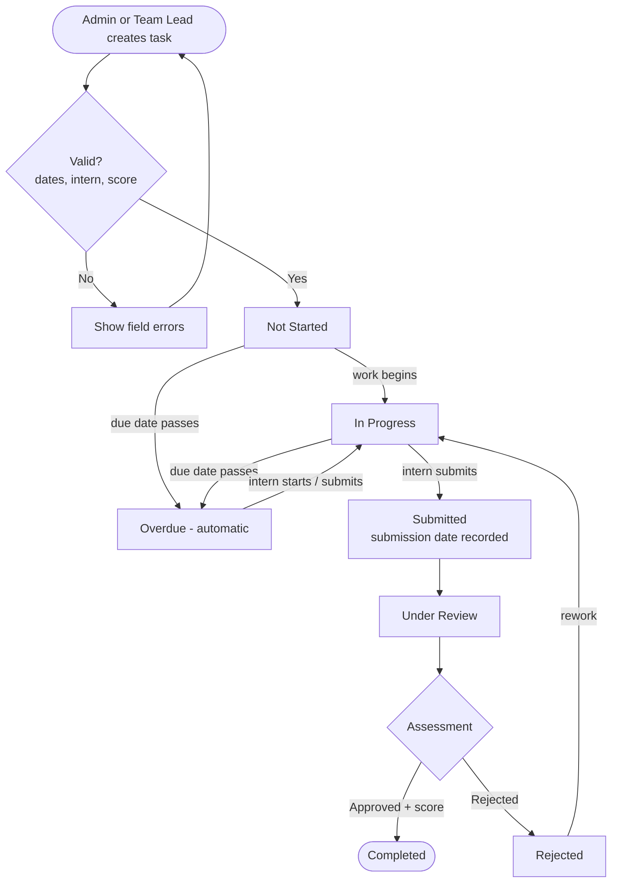
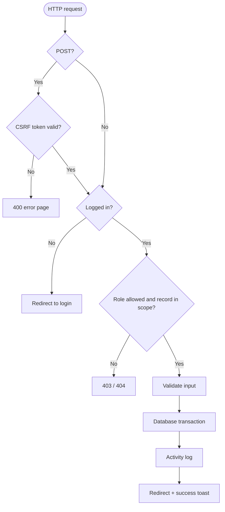

# System Architecture and Flowcharts

## Architecture

Layers: **presentation** (Jinja2 templates, CSS, JS) - **application** (Flask routes, security, validation) - **data** (SQLite via sqlite3 with foreign keys ON). One connection per request; transactions are committed or rolled back in `write()`.

## Flowchart: task lifecycle

## Flowchart: request handling and security

