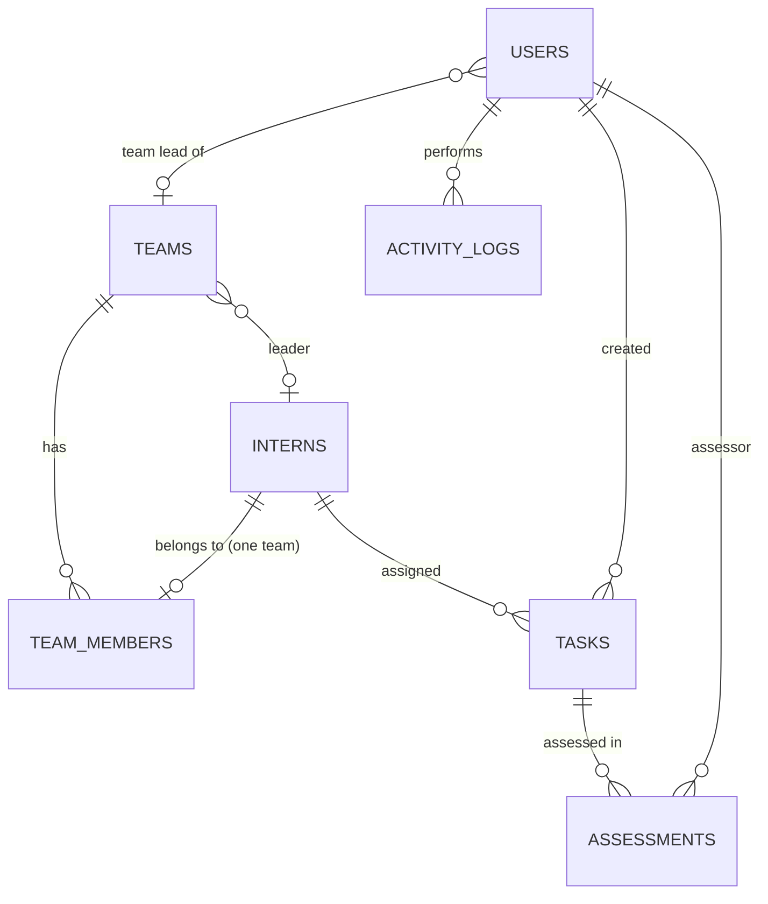

# Database Schema (SQLite) - source: `schema.sql`

| Table | Key columns | Constraints |
|---|---|---|
| **users** | id PK, username, password_hash, full_name, role, team_id FK, is_active | username UNIQUE (nocase); role IN (admin, team_lead); team_id -> teams ON DELETE SET NULL |
| **interns** | id PK, name, dit_id, email, phone, college, role, joining_date | **dit_id UNIQUE (nocase)**, all NOT NULL |
| **teams** | id PK, name, description, leader_id FK | name UNIQUE (nocase); leader_id -> interns ON DELETE SET NULL |
| **team_members** | id PK, team_id FK, intern_id FK | intern_id UNIQUE (one team per intern); both FKs ON DELETE CASCADE |
| **tasks** | id PK, task_code, title, description, intern_id FK, assigned_date, due_date, submission_date, status, assessment_status, assessment_score, remarks, created_by FK | task_code UNIQUE; CHECK status in 7 values; CHECK assessment_status in 4 values; CHECK score 0-100; CHECK due_date >= assigned_date; intern_id ON DELETE CASCADE |
| **assessments** | id PK, task_id FK, assessor_id FK, status, score, remarks, assessed_at | history of every assessment; task_id ON DELETE CASCADE |
| **activity_logs** | id PK, user_id FK, username, action, entity, entity_id, details, ip_address, created_at | user_id ON DELETE SET NULL |

Indexes: tasks(intern_id), tasks(status), tasks(due_date), team_members(team_id), assessments(task_id), activity_logs(created_at).

**Overdue logic (queries.py):** the stored `status` is never silently changed. A computed column `eff_status` returns `Overdue` when `status IN ('Not Started','In Progress') AND due_date < today`; all dashboards, filters and reports use `eff_status`.
